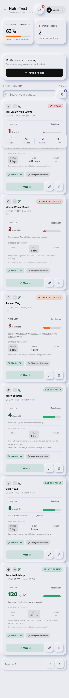
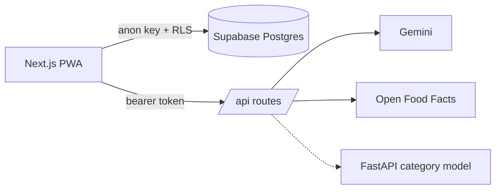

  # Nutri-Trust — Smart Pantry

[](https://github.com/npshetty25/NutriTrusto/actions/workflows/ci.yml)

A pantry tracker for Indian households that cuts food waste: scan a barcode or
a receipt, see what is about to expire, and get a recipe that uses it up first.
Pantries can be shared across a household with row-level security enforcing who
sees what.

**Live:** https://nutri-trusto.vercel.app · installable as a PWA

<p align="center">
  
</p>

<sub>Screenshot rendered from synthetic pantry data in a test browser, not a real account.
There is no demo GIF yet.</sub>

## What it does

- **Scan in** — barcode (camera or typed), receipt photo, nutrition label,
  printed expiry date. Gemini reads the images; Open Food Facts resolves barcodes.
- **Know what is expiring** — shelf-life estimates with their source shown on
  the card, risk bands, and a plain "past our estimate, check it yourself" rather
  than a claim that food has spoiled.
- **Cook it** — Indian recipes generated from what expires first, validated
  server-side against the user's diet (vegetarian / eggtarian) before they are shown.
- **Share it** — households with invite codes, a shared pantry, per-user
  shopping list and impact dashboard.
- **Category hint** — a trained model suggests a category for scanned products.

## Architecture



The dotted edge is optional. Full diagram, trust boundaries and request flows:
[docs/ARCHITECTURE.md](docs/ARCHITECTURE.md).

## Engineering evidence

| | |
|---|---|
| **Tests & CI** | Vitest unit/component/API-route tests, RLS policies run against real Postgres (PGlite), Playwright browser journeys on phone and desktop and a pytest job for the model service. All on every push: [workflow](.github/workflows/ci.yml) |
| **RLS & the 42P17 fix** | [db/rls.test.ts](db/rls.test.ts) proves the policies and includes a negative control that *does* raise `42P17`. It also guards the fix for a cross-household write issue the tests found (`db/supabase-schema-household-guard.sql`) |
| **Responsive & PWA** | Before/after measurements in [docs/audit/PHASE1_RESULTS.md](docs/audit/PHASE1_RESULTS.md); a browser test fails the build if a tap target drops below 44px |
| **Load test** | [docs/perf/LOAD_TEST.md](docs/perf/LOAD_TEST.md) — labelled synthetic, with its limits stated |
| **ML model** | [ml/README.md](ml/README.md) — dataset, licence, metrics against the existing keyword rules, calibration, known misses |
| **Audit** | [docs/audit/PHASE0_AUDIT.md](docs/audit/PHASE0_AUDIT.md) |

## Stack

- **Next.js 16** (App Router, Turbopack), React 19, TypeScript, Tailwind v4
- **Supabase** — Postgres, Auth, Realtime, row-level security, security-definer functions
- **Google Gemini** (`gemini-2.5-flash`) — receipt, label and expiry OCR; recipes; chat
- **Open Food Facts** — barcode lookup
- **scikit-learn + FastAPI** — category classifier service
- **Vitest, Testing Library, PGlite, Playwright, pytest** — tests
- **GitHub Actions** — CI
- **Vercel** — hosting

## Run it

### Locally

```bash
npm install
cp .env.local.example .env.local   # fill in Supabase and Gemini values
npm run dev                        # http://localhost:3000
```

| Variable | Used for |
| --- | --- |
| `NEXT_PUBLIC_SUPABASE_URL`, `NEXT_PUBLIC_SUPABASE_ANON_KEY` | Supabase project (public values) |
| `GEMINI_API_KEY` | Scanning, recipes and chat (server only) |
| `ML_SERVICE_URL` | *(optional)* category model service; unset → keyword rules |
| `NEXT_PUBLIC_GOOGLE_SIGNIN` | *(optional)* `1` shows "Continue with Google" once it is set up in Supabase |
| `OFF_USER_ID`, `OFF_PASSWORD` | *(optional)* contribute barcodes to Open Food Facts |

### Database

Run in the Supabase SQL editor, in order: `db/supabase-schema.sql`,
`db/supabase-schema-additions.sql`, `db/supabase-schema-hardening.sql`,
`db/supabase-schema-household-guard.sql`. All are
idempotent. There is no migration ledger; the repo cannot tell you which have
been applied to a given project.

Feature migrations follow; each says at its top what must run before it, and
the app checks for each column and keeps working without it. The newest,
`db/supabase-schema-printed-date.sql`, keeps the date printed on a pack, so one
added after its date reads "10 days ago" rather than "today".

### Password reset

"Forgot password?" emails a Supabase recovery link that returns to
`/reset-password`. Two settings in the Supabase dashboard make it work for
everyone:

- **Authentication → URL Configuration → Redirect URLs**: add
  `https://<your-domain>/reset-password`. Without it Supabase sends the link to
  the Site URL instead; the app still forwards it to `/reset-password`.
- **Authentication → SMTP Settings**: Supabase's built-in mailer only delivers
  to members of the project's own team, about two emails an hour. Real users
  get the email only once a custom SMTP server is set up.

### Tests

```bash
npm run lint && npm run typecheck
npm test                  # unit, component, API-route and RLS tests
npm run test:coverage
npm run test:e2e          # builds, then runs Playwright (phone + desktop + PWA)
pytest ml/service         # model service
```

## Known limitations

- Rate limiting is per server instance, in memory.
- `src/app/page.tsx` is ~2,900 lines; it is covered by browser tests, not unit tests.
- Statement coverage is about a third of `src/` — high where logic lives
  (`lib`, API routes), near zero on the big page component.
- The category model is trained on packaged-product names and mislabels fresh
  produce; it is not wired to anything that spends money.

## Layout

```
src/app/         routes, layout, API routes (/api/health, /api/categorize, …)
src/components/  UI components
src/lib/         matchers, shelf-life data, auth, rate limit, upload validation
db/              SQL migrations; db/proposed/ holds reviewed-but-unapplied ones
e2e/             Playwright specs and the fake backend they run against
ml/              data fetch, training, evaluation, service, committed model
perf/            Locust load test and stub
docs/            architecture, ADRs, audits, perf report
```

`FEATURE_IDEAS.md` tracks planned and shipped features; `CHANGELOG.md` records
every change to shelf-life data with the reason.
