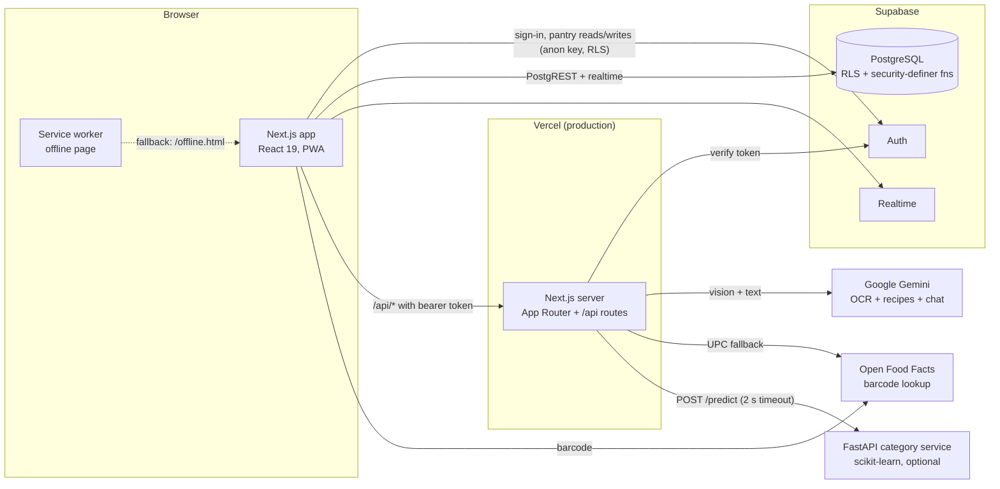

# Architecture

## Runtime view

The dotted edge is optional: the app works without the ML service.

## Where each datastore is used, and why

| Store | Holds | Why this store |
|---|---|---|
| **PostgreSQL** (Supabase) | pantry, households, membership, shopping list, scan history, outcomes | Relational, needs transactions (`create_household` is atomic) and per-user/household isolation, which row-level security gives at the database rather than in application code |
| **Browser storage** | theme preference, Supabase session | Per-device convenience only |

## Trust boundaries

1. **The browser is not trusted with anything.** Pantry reads and writes go
   straight to PostgREST with the public anon key; row-level security decides
   which rows a request can touch. That policy set is exercised against a real
   Postgres in `db/rls.test.ts`.
2. **Every `/api/*` route requires a Supabase bearer token**, verified against
   Supabase Auth (`src/lib/api-auth.ts`), then rate-limited per user. It fails
   closed: no config, a thrown error or a rejected token all mean 401.
3. **Uploads are checked by their bytes**, not their declared type, and capped
   at 10 MB, before any paid call (`src/lib/upload-validation.ts`).
4. **Secrets**: only `NEXT_PUBLIC_*` values (public by design) are build
   values. `GEMINI_API_KEY` and Open Food Facts credentials
   are runtime variables and never enter an image layer.

## Request flow: scanning a receipt

1. Browser posts the photo to `/api/extract` with `Authorization: Bearer …`.
2. Route verifies the token, applies the 10-per-minute limit, validates the file.
3. Gemini reads the receipt and returns JSON.
4. The route normalises it (trim names, clamp days to 1–3650, map risk) and
   returns the items.
5. The browser inserts the rows into `pantry_items` through PostgREST, where
   RLS applies, and logs the scan to `scan_history`.

## Request flow: category hint

After a barcode scan the dashboard asks `/api/categorize` for the product's
category. If `ML_SERVICE_URL` is set the trained model answers with a
probability; if it is unset, slow (> 2 s) or failing, the keyword rules answer
and the response says `"source": "rules"`. The UI never shows a keyword guess as
a model prediction.

## Deployment shapes

| Shape | Status |
|---|---|
| Vercel from `master` | **Live.** `https://nutri-trusto.vercel.app` |

## Health and observability

- `GET /api/health` — readiness: Supabase Auth health plus a PostgREST request.
  200 `ok`, or 503 `degraded` with per-dependency reason and latency.
- `GET /api/health?probe=live` — liveness, touches nothing. Used by the
  container `HEALTHCHECK` so a database blip cannot restart a healthy process.
- Server logs are one JSON object per line (`ts, level, route, requestId, msg,
  durationMs, meta`).
- No error-tracking service is connected.

## Known architectural limits

- Rate limiting is **per server instance, in memory**. It stops one account
  looping a button; it is not a distributed limit.
- `src/app/page.tsx` is a ~2,900-line client component holding most of the
  dashboard's logic. It is covered by browser tests, not unit tests.
- The service worker does not provide offline data: the pantry needs Supabase.
  Offline, the user gets an honest offline page.
- Database migrations are hand-run SQL files with no applied-state ledger.
